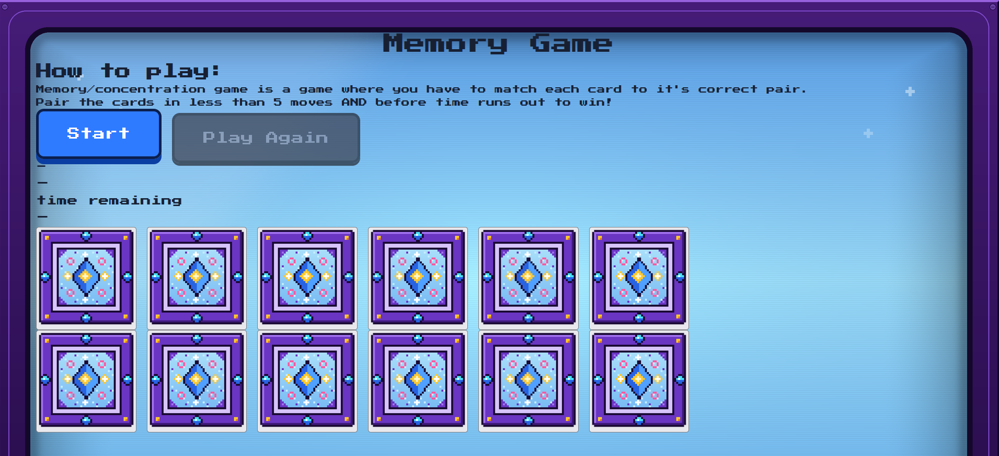

# memory-game

### Game Description
- Player must pick and match all cards to their respective pairs before time runs out!
If the player gets all the correct matches, they win!

- The player has a time limit of 45 seconds to match all cards. If time is up , they lose!

- If the player makes 5 wrong moves , they lose!

### Getting Started

- Open the [link to the game](https://github.com/LunarAphelios/memory-game)

- To start the game, press the Start button at the top of the page.

- Match the cards to their correct pair in less than 5 moves and before time runs out.

- After the game is done (win/loss) , press the Play Again button to start another round.

### Credits

- The arcade-style button CSS (Start and Play Again) ,Font,Audio and Images in this project was created with the help of [Claude](https://claude.ai), an AI assistant made by [Anthropic](https://www.anthropic.com).

- Credits to Youtube and Riot Games for using a background music theme , [Bit-Rush](https://www.youtube.com/watch?v=DYW-kEiCnJI&list=RDDYW-kEiCnJI&start_radio=1)

### Technologies

- HTML
- CSS
- JavaScript

### Future Enhancements

- Adding more assets (audio and graphic) to make the game more presentable

- Add different difficulties (ex. hard mode)

